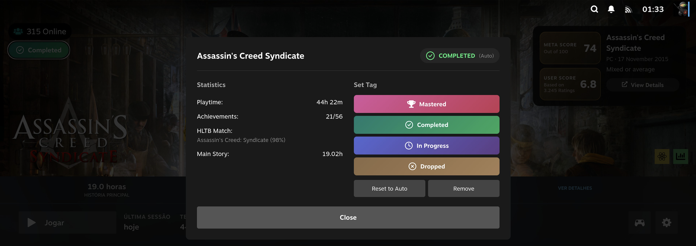
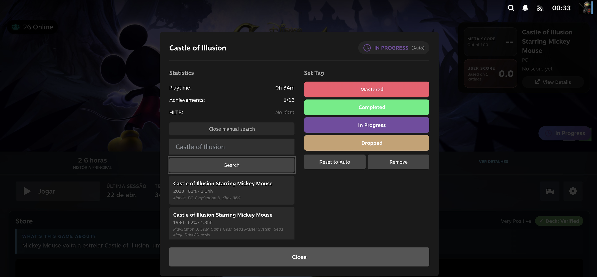
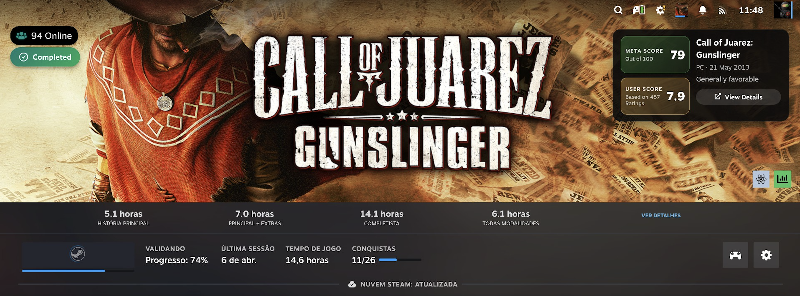
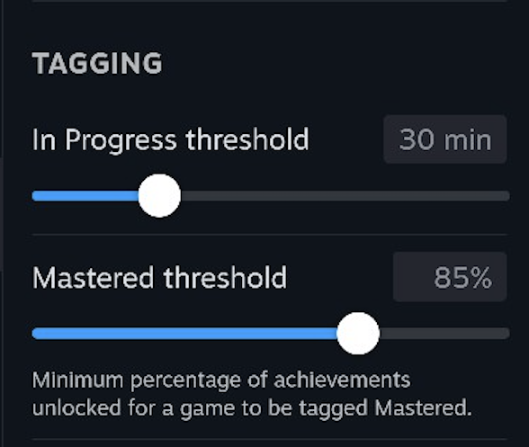
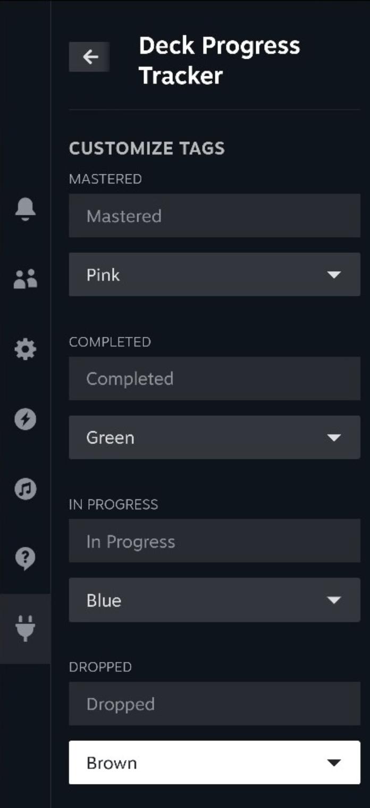

# Deck Progress Tracker

A Decky Loader plugin for Steam Deck that automatically tags your games based on achievements, playtime, and [HowLongToBeat](https://howlongtobeat.com/) data:

| Tag             | Criteria                                                         |
| --------------- | ---------------------------------------------------------------- |
| **Mastered**    | Achievement percentage ≥ your configured threshold (default 85%) |
| **Completed**   | Playtime ≥ HLTB main story time                                  |
| **In Progress** | Playtime ≥ your configured threshold (default 30 minutes)        |
| **Dropped**     | Not played for over 1 year                                       |
| **Backlog**     | Not started yet                                                  |

You can also manually override any tag if the automatic detection isn't right for you, search HowLongToBeat manually when the automatic match is missing or wrong, and rename/recolor each tag to your liking.

Steam tools and apps (dedicated servers, SDKs, redistributables, etc.) are automatically detected and hidden so they don't clutter your Backlog.

## Features

- **Automatic tagging** from real playtime, achievements, and HowLongToBeat completion times - including non-Steam games (via session tracking and `localconfig.vdf`)
- **Configurable thresholds**: adjust the achievement percentage required for Mastered and the playtime required for In Progress
- **Manual HLTB search**: look up and pick the correct HowLongToBeat match yourself when the automatic search fails or picks the wrong game
- **Customizable tags**: rename any tag label and pick its color from a curated palette, with a one-click reset to defaults
- **Configurable badge position**: place the progress badge anywhere on the game banner (left/center/right × top/center/bottom), with a vertical nudge offset to avoid overlapping another plugin's badge in the same spot
- **Localization**: English and Brazilian Portuguese, auto-detected from your system language with a manual override
- **Full gamepad navigation** throughout the badge, tag dialog, and Settings panel
- Automatically filters out non-game Steam tools/apps from your library

## Screenshots

The plugin dashboard showing a library of 809 games organized by tags - In Progress (21), Completed (18), Mastered (1), and Dropped (19).

The tag management dialog with improved contrast, showing statistics, HLTB match, and manual tag controls.

Manual HowLongToBeat search, letting you pick the correct match when the automatic search is missing or picked the wrong game.

The progress badge repositioned to the top-left of the game banner, avoiding another plugin's badge in the default corner.

Configurable thresholds for the In Progress and Mastered tags.

Custom labels and colors for each tag.

## Sponsor

If you find this plugin useful, consider supporting its development — it helps me keep it free, fix bugs, add new features, and stay compatible with Steam Deck updates.

## Installation

### Via URL (Recommended)

1. Open Decky Loader on your Steam Deck (QAM → Plugin icon)
2. Navigate to Settings → Developer Mode
3. Enable Developer Mode
4. Install from URL: `https://github.com/btd1337/deck-progress-tracker/releases/latest/download/deck-progress-tracker.zip`
5. Restart Decky if prompted

### Manual Installation

1. Download the latest release from [GitHub Releases](https://github.com/btd1337/deck-progress-tracker/releases)
2. Extract to: `~/homebrew/plugins/deck-progress-tracker/`
3. Restart Decky Loader

## Tag Logic

The plugin uses a priority-based system where higher priority tags override lower ones:

### 1. Mastered (Highest Priority)

- Requires: achievement percentage ≥ your configured threshold (default 85%, adjustable in Settings)
- Shows true game mastery beyond basic completion
- Priority: Overrides all other tags

### 2. Completed

- Requires: Playtime ≥ HLTB main story completion time
- Indicates you've beaten the main story
- Priority: Overrides Dropped, In Progress, Backlog

### 3. Dropped

- Requires: Game not played for 365+ days
- Only applies if not Mastered or Completed
- Automatically detected by daily background task
- Priority: Overrides In Progress, Backlog

### 4. In Progress

- Requires: Playtime ≥ your configured threshold (default 30 minutes, adjustable in Settings)
- Currently playing or recently played
- Priority: Overrides Backlog only

### 5. Backlog (Lowest Priority)

- No significant playtime
- Not started yet
- Default tag for games not matching other criteria

**Example**: A game with 90% achievements and 1+ year since last play will be tagged as **Mastered** (not Dropped), because Mastered has higher priority.

## Support

- **Issues:** [GitHub Issues](https://github.com/maroun2/deck-progress-tracker/issues)
- **Discord:** [Decky Loader Discord](https://deckbrew.xyz/discord)
- **Documentation:** [Decky Wiki](https://wiki.deckbrew.xyz/)

## License

BSD-3-Clause License - see [LICENSE](LICENSE) file

## Credits

- Built with [Decky Loader](https://github.com/SteamDeckHomebrew/decky-loader)
- Game completion data from [HowLongToBeat](https://howlongtobeat.com/)
- Python HLTB integration via [howlongtobeatpy](https://github.com/ScrappyCocco/HowLongToBeat-PythonAPI)
